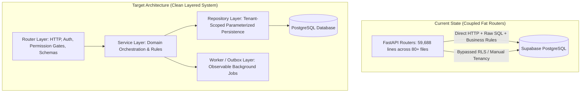

# AEGIS Architecture Refactor Plan

**System**: Project AEGIS / Imperium Operations Platform  
**Target Enterprise**: Six Nine Construction (Pvt) Ltd (SNC)  
**Authority**: Master System Architect & Product Integrity Lead  
**Operating Directive**: Staged, behavior-preserving domain extraction. Zero big-bang rewrites. Keep business corrections and architectural refactorings in separate, reviewable patches.

---

## 1. Current Architecture vs. Target Architecture

### Layer Responsibilities
1. **Router Layer (`routers/`)**:
   - HTTP routing, method definitions, status codes.
   - User authentication and permission dependency injection (`require_permission`).
   - Pydantic v2 payload validation and response serialization.
   - Zero inline SQL; zero multi-step business transactions.
2. **Service Layer (`app/services/`)**:
   - Domain business logic, state machines, workflow validations.
   - Transaction boundaries and cross-entity orchestration (e.g. `inventory_service.py`, `procurement_service.py`).
   - Event emission (`emit_event`) and audit trail dispatch.
3. **Repository Layer (`app/repositories/`)**:
   - Parameterized SQL execution and SQLAlchemy query compilation.
   - Enforced tenant isolation filtering (`WHERE organization_id = :org_id`).
   - Row-level locking primitives (`SELECT ... FOR UPDATE`).
   - Bounded cursor pagination and result-set mapping.
4. **Shared Core (`core/`)**:
   - Database connection management and pool telemetry (`core/database.py`).
   - Central authentication, JWT verification, and RBAC registry (`core/security.py`).
   - Structured JSON logging and correlation tracking (`core/logging.py`).
   - Global exception handling and rate limiting.

---

## 2. Domain-by-Domain Refactor Order

Refactoring follows risk and dependency hierarchy:

| Priority | Domain Router | Current Lines | Raw SQL Queries | Risk Profile | Target Service Module |
|---|---|---|---|---|---|
| **Step 1** | `routers/inventory.py` | 697 | 18 | HIGH (Concurrency / Double-Spend) | `app/services/inventory_service.py` (Completed) |
| **Step 2** | `routers/executive.py` | 2,140 | 42 | HIGH (Fan-out / Latency) | `app/services/executive_service.py` (Bundle Added) |
| **Step 3** | `routers/procurement.py` | 2,850 | 78 | HIGH (3-Way Match / Spend) | `app/services/procurement_service.py` |
| **Step 4** | `routers/site_reports.py` | 3,120 | 85 | CRITICAL (Safety / Payroll Gates) | `app/services/site_reports_service.py` |
| **Step 5** | `routers/projects.py` | 2,450 | 64 | HIGH (Core Budget / Master) | `app/services/project_service.py` |
| **Step 6** | `routers/fleet.py` | 1,980 | 48 | MEDIUM (Fuel / Asset Costs) | `app/services/fleet_service.py` |
| **Step 7** | `routers/crm.py` | 2,210 | 52 | MEDIUM (Tender / Bid Management) | `app/services/crm_service.py` |

---

## 3. Migration & Refactor Strategy

1. **Extract Without Changing Contracts**: Extract private service methods from existing fat router functions without modifying endpoint URLs, HTTP methods, payload schemas, or response shapes.
2. **Atomic Row-Locking by Default**: All inventory mutations, budget allocations, and status transitions must acquire `FOR UPDATE` locks on target root entities.
3. **Contract Test Pinning**: Before altering any router, write a contract test in `imperium-api/tests/` asserting that all route signatures, status codes, and emitted event types remain unchanged.
4. **Rollback Strategy**: Every extracted service is paired with its original router version; git revert can immediately roll back any regression without database schema entanglement.
