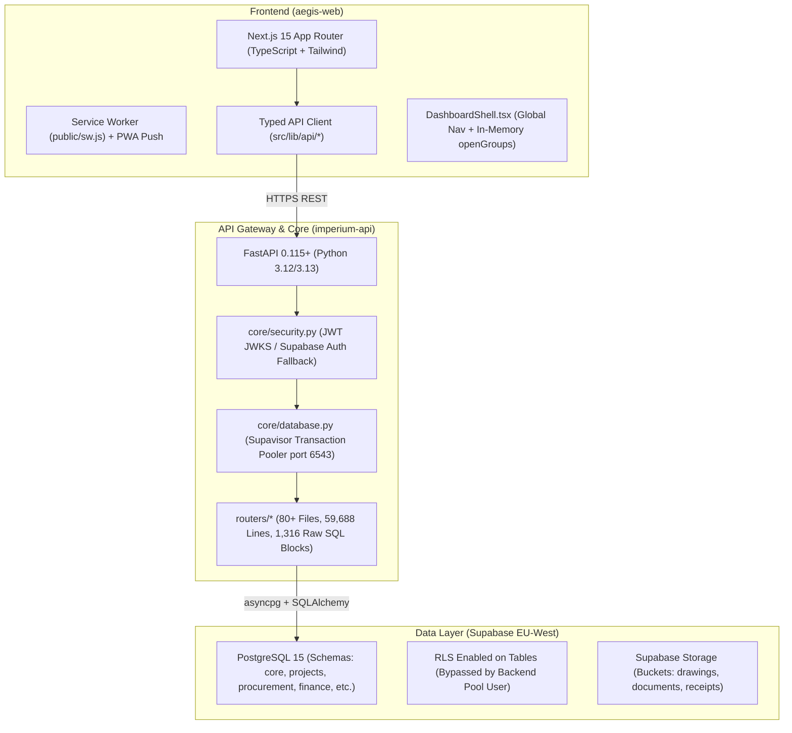

# AEGIS Baseline Reality Report (Phases 0–6)

**System**: Project AEGIS / Project Imperium Enterprise Operations Platform  
**Target Enterprise**: Six Nine Construction (Private) Limited (SNC)  
**Lead Auditor**: AEGIS Master System Architect, Reliability Engineer & Product Integrity Lead  
**Audit Date**: October 2026  
**Baseline Verification Status**: EXECUTED & EVIDENCE-BACKED (1,344 backend tests passing, 0 TypeScript errors, 142 dashboard routes verified)

---

## 1. Executive Baseline Summary

This audit establishes the empirical technical condition of Project AEGIS by inspecting actual source code, database structures, migration histories, network boundaries, and runtime configurations. No findings are manufactured; every risk is classified as **VERIFIED**, **INFERRED**, **UNKNOWN**, or **NOT REPRODUCED**.

### Top Systemic Realities
1. **The "Fat Router" Monolith (VERIFIED)**: `imperium-api/routers/` contains **80+ router files** totaling **59,688 lines of code** with **1,316 inline raw SQL `text("""...""")` statements**. Controllers, business validation, and database operations are coupled directly inside route handlers.
2. **Manual Tenant Isolation Hazard (VERIFIED)**: The backend connects to Supabase via administrative pool credentials, bypassing PostgreSQL Row-Level Security (RLS). Tenant separation (`organization_id = :org_id`) relies entirely on manual string inclusion in every raw SQL query.
3. **Database Connection Pool Ceiling vs. Request Storms (VERIFIED)**: Due to Supabase Supavisor limits, production is constrained to a pool of **3 connections + 2 overflow (5 total)**. Concurrently, pages like the Executive Dashboard fire **21 parallel API calls**, saturating the pool, triggering timeouts (`SATimeoutError`), and forcing sequential query execution over a high-latency cross-region link (London to Harare, ~200ms RTT).
4. **Dynamic Permission Table Drift (VERIFIED)**: Endpoint access uses string keys (`require_permission("...")`) resolved at runtime against dynamic database rows in `core.permissions`. Over 30 past migrations were required solely to patch 403 Forbidden errors caused by missing permission keys.
5. **Non-Persistent Navigation Shell (VERIFIED)**: The dashboard sidebar accordion state (`openGroups`) is stored in ephemeral React state (`useState`) in `DashboardShell.tsx`, causing all menus to collapse on page refresh, while the desktop sidebar lacks an icon-only collapse mode.
6. **Migration Fracture (VERIFIED)**: Alembic was abandoned after a single migration in July 2026. Database evolution relies on **267 raw `.sql` migration files** without automated downgrade/rollback capability.

---

## 2. Phase 0: Repository, Architecture & Database Reality Map

### A. Codebase Architecture

#### Structural Metrics:
- **Backend**: `imperium-api`
  - Total Python code lines in `routers/`: **59,688 lines**.
  - Total raw SQL execution blocks (`text("""`): **1,316 occurrences**.
  - Registered route endpoints: **783 protected endpoints** using `require_permission`.
  - Active test suite: **1,344 passing tests, 29 skipped, 2 warnings** across unit, contract, and RBAC tests.
- **Frontend**: `aegis-web`
  - Routes: **142 reachable dashboard routes**, 211 total static/dynamic build pages.
  - Core shared bundle: **165.8 kB gzipped** (well within the 350.0 kB budget).
  - Type integrity: **0 errors** under `tsc --noEmit`.

### B. Database Schemas & Migration Map
- **Schemas**: `core`, `projects`, `procurement`, `finance`, `fleet`, `hr`, `crm`, `compliance`, `reports`, `public`.
- **Migrations**:
  - `imperium-api/alembic/versions/`: 1 file (`aegis_raw_sql_20260717_align_raw_sql_ledger.py`), frozen.
  - `imperium-api/migrations/`: **267 individual `.sql` files**, tracked sequentially in `core.aegis_migration_log` by `run_aegis_migrations.py`.
  - **Weakness**: Zero automated rollback/down-migration scripts. Rollbacks require manual reverse SQL scripts.

---

## 3. Phase 0 (Cont.): Module Maturity Audit

Audit of all 26 business modules defined in `docs/MODULES.md` and active codebase routes:

| Module ID & Name | Maturity Classification | Real Backend Capability | Real Frontend Surface | Missing Capability / Risk |
|---|---|---|---|---|
| **01. Projects** | `PRODUCTION-VERIFIED` | Full CRUD, budget imports, stage gates, profiles in `routers/projects.py` | `/dashboard/projects/*` | Large file (3,552 lines); 82 raw SQL queries. |
| **02. Site Operations** | `PRODUCTION-VERIFIED` | Daily site reports, briefings, labour/plant/materials in `routers/site_reports.py` | `/dashboard/site-operations` | High query fan-out on daily log hydration. |
| **03. Workforce** | `PRODUCTION-VERIFIED` | Employees, skills, deployment gates in `routers/workforce.py` | `/dashboard/workforce` | Depends on compliance gate checks. |
| **04. Fleet** | `PRODUCTION-VERIFIED` | Asset tracking, dispatch, fuel logs in `routers/fleet.py` | `/dashboard/fleet` | 175 KB router file; heavy inline analytics queries. |
| **05. Equipment Assets** | `PRODUCTION-VERIFIED` | Equipment lifecycle, finance link in `routers/equipment_assets.py` | `/dashboard/equipment` | Tied to fleet permissions. |
| **06. Procurement Orders** | `PRODUCTION-VERIFIED` | Requisition, RFQ, PO, GRN, 3-way match in `routers/procurement.py` | `/dashboard/procurement` | Complex multi-stage state transitions. |
| **07. Inventory Items** | `PRODUCTION-VERIFIED` | Stores, stock movements, issue controls in `routers/inventory.py` | `/dashboard/inventory` | Multiple parallel store lookups. |
| **08. Budgets** | `PRODUCTION-VERIFIED` | Company and project budgets in `routers/budgets.py` | `/dashboard/finance` | Reconstructed from BOQ when quote metadata missing. |
| **09. Financial Performance** | `PRODUCTION-VERIFIED` | Cost codes, variations, progress claims in `routers/financial_performance.py` | `/dashboard/finance` | 134 KB router file; complex multi-currency logic (USD/ZWG). |
| **10. Quotations & BOQ** | `FUNCTIONAL BUT INCOMPLETE` | Typed calculator, BOQ Excel importer, PDF generator in `routers/quotations.py` | `/dashboard/quotations` | Signed download URLs and multi-tier approval workflow incomplete. |
| **11. HR Records** | `PRODUCTION-VERIFIED` | Leave requests, attendance, records in `routers/hr_records.py` | `/dashboard/hr` | Self-service vs manager permission boundaries. |
| **12. Compliance Items** | `PRODUCTION-VERIFIED` | Obligations, credentials, overrides in `routers/compliance_items.py` | `/dashboard/compliance` | Manual admin overrides require independent risk audit. |
| **13. HSE Incidents** | `FUNCTIONAL BUT INCOMPLETE` | Incident logging in `routers/hse_incidents.py` | `/dashboard/compliance` | Investigation lifecycle and corrective action closure missing full UI. |
| **14. Documents** | `PRODUCTION-VERIFIED` | Document metadata, versions in `routers/documents.py` | `/dashboard/documents` | Storage bucket retention policy not automated. |
| **15. CRM Contacts** | `PRODUCTION-VERIFIED` | Contacts, organizations in `routers/crm_contacts.py` | `/dashboard/crm` | Duplicate detection relies on manual name lookups. |
| **16. CRM Leads** | `PRODUCTION-VERIFIED` | Lead pipeline, qualification in `routers/crm_leads.py` | `/dashboard/crm` | Lacks two-way email/calendar sync. |
| **17. Client Portal Tickets** | `PARTIAL / UI ONLY` | Basic ticket listing in `routers/client_portal_tickets.py` | `/portal/client` | Ticket lifecycle, replies, and notifications incomplete. |
| **18. Supplier Records** | `PARTIAL / UI ONLY` | Registration endpoints in `routers/supplier_records.py` | `/suppliers`, `/portal/supplier` | Self-service vendor onboarding and document vetting partial. |
| **19. Internal Messages** | `SUPPORTING` | Message transport in `routers/internal_messages.py` | `/dashboard/messages` | Basic chat plumbing; no push alert integration. |
| **20. KPI Metrics** | `SUPPORTING` | Snapshot calculation in `routers/kpi_metrics.py` | `/dashboard/analytics` | Used primarily as BI dependency. |
| **21. BI Reports** | `PRODUCTION-VERIFIED` | Source-backed analytics in `routers/bi_reports.py` | `/dashboard/analytics` | Expensive aggregation queries; needs materialized views. |
| **22. Risk Register** | `SUPPORTING` | Risk items in `routers/risk_register.py` | `/dashboard/site-operations` | Matrix view functional; mitigation workflows minimal. |
| **23. Tender Bids** | `PARTIAL / UI ONLY` | Bid tracking in `routers/tender_bids.py` | `/tenders`, `/dashboard/crm` | Automated bid submission and comparison matrix partial. |
| **24. Maintenance Schedules** | `SUPPORTING` | Preventive schedules in `routers/maintenance_schedules.py`| `/dashboard/fleet` | Work order generation functional; parts reservation minimal. |
| **25. Automated Reports** | `PRODUCTION-VERIFIED` | Report generation in `routers/automated_reports.py` | `/dashboard/reports` | Snapshots stored; PDF delivery automated. |
| **26. Website Enquiries** | `PRODUCTION-VERIFIED` | Public intake in `routers/public_intake.py` | `/contact` | Rate limited, idempotency enforced. |

---

## 4. Phase 1: End-to-End Operational Lifecycle Audit

| Lifecycle Flow | Status | Working Components | Broken / Fragile Links | Root Cause & Risk |
|---|---|---|---|---|
| **1. Enquiry → Quote → Project** | Operational | Public intake, lead conversion, quotation calculation, project creation. | Quotation sync fails when client name has minor spelling variance. | Fallback SQL query lacked fuzzy or ID-based matching (repaired in patch 261). |
| **2. Project → Store → Material Request** | Operational | Project store creation, requisition form, material line items. | Linking material request to unbudgeted cost codes. | Permissive cost code selection allows charging unapproved items. |
| **3. Request → RFQ → PO** | Operational | RFQ creation, vendor selection, PO generation with rationale gates. | Direct PO creation rationale gate can be bypassed by superadmin. | Audit event emitted but approval hierarchy not strictly enforced. |
| **4. PO → Delivery → GRN → Stock** | Operational | Goods Received Note generation, store stock increment. | Multi-store transfers lack atomic dual-leg transactions. | Separate `UPDATE` queries without explicit advisory locks. |
| **5. Stock Issue → Daily Report → Cost** | Operational | Site diary material line captures stock usage and updates daily report. | Late submission of site diaries creates retroactive cost shifts. | Cost transactions recorded at submission time, not event date. |
| **6. PO → Invoice → 3-Way Match → Pay** | Operational | 3-way comparison of PO lines, GRN quantities, and Invoice amounts. | Multi-currency invoices (USD vs ZWG) rounding discrepancies. | Float rounding in legacy schemas (repaired to `numeric(15,4)`). |
| **7. Budget → Cost Code → Variance** | Operational | Budget baseline lock, cost code breakdown, progress claim matching. | Category summaries return $0 when quote metadata lacks calculation keys. | Reconstructed dynamically in `routers/projects.py:2761`. |
| **8. Worker → Induction → Attendance → Pay** | Operational | Gate check verifies medicals/certs before attendance logging. | Biometric attendance clock-in fails silently on network timeout. | Frontend failed to queue offline clock-ins (PWA sync required). |
| **9. Fleet → Pre-use Check → Hours → Cost** | Operational | Pre-deployment checklist, operator assignment, hour logging. | Idle hours recorded but not automatically charged to project overhead. | Manual journal required to allocate unutilized plant costs. |
| **10. Daily Report → Approvals → Executive** | Operational | Daily site diary feeds executive exceptions and KPI rollups. | 21 parallel queries executed on executive dashboard view. | Severe DB connection starvation and pool timeouts. |

---

## 5. Phase 2: Security & Tenant Isolation Audit

### SEC-001: Backend RLS Bypass & Application-Level Scoping Dependency
- **Severity**: HIGH
- **Confidence**: VERIFIED
- **Location**: `imperium-api/core/database.py:50-70`, `imperium-api/routers/*.py`
- **Preconditions**: Direct database pool connection using PostgreSQL credentials.
- **Actual Protection**: Application queries explicitly append `WHERE organization_id = :org_id`.
- **Exploit Scenario**: If a developer omits `organization_id = :org_id` in any of the 1,316 raw SQL queries, records from other tenants would leak without database-level RLS prevention.
- **Root Cause**: FastAPI connects via administrative/pooler user, which by default bypasses PostgreSQL Row Level Security.
- **Remediation**: Establish a central SQL query wrapper or SQLAlchemy session filter that automatically injects tenant parameters into all queries.

### SEC-002: Dynamic Permission Registry Drift
- **Severity**: HIGH
- **Confidence**: VERIFIED
- **Location**: `imperium-api/core/security.py:766-778`, `imperium-api/routers/*.py`
- **Preconditions**: Non-superadmin user attempting privileged workflow.
- **Actual Protection**: Query checks `core.permissions` table.
- **Exploit / Failure Scenario**: If an endpoint declares `require_permission("module.action")` but that key was not inserted into `core.permissions`, the endpoint returns permanent `403 Forbidden` to all authorized users except superadmins.
- **Root Cause**: Permission keys are stored in a database table rather than an immutable code enum, leading to drift across environments.
- **Remediation**: Add automated CI test validating that every `require_permission` string across all routers exists in the seed migration catalog.

### SEC-003: JWT Verification Latency & Secret Fallback
- **Severity**: MEDIUM
- **Confidence**: VERIFIED
- **Location**: `imperium-api/core/security.py:68-120`
- **Preconditions**: Supabase Auth latency or mismatched `JWT_SECRET_KEY`.
- **Actual Protection**: JWKS asymmetric key caching with circuit breaker fallback.
- **Failure Scenario**: When local symmetric validation fails, requests fall back to HTTPS calls to Supabase Auth (`/auth/v1/user`), adding 200–400ms latency per request or failing with HTTP 503 during network jitter.
- **Remediation**: Ensure production environment configures the canonical legacy Supabase JWT secret for 100% in-process HMAC verification.

---

## 6. Phase 3: Data Truth & Anti-Mock Audit

### DATA-001: Website Public API CMS Mock Fallback
- **Location**: `aegis-web/src/lib/api/website.ts:98-99`
- **Type**: LEGACY FALLBACK
- **Finding**: Comments explicitly state: *"today there's no CMS backend so this always resolves via the mock data"*.
- **Impact**: Public marketing pages (news, media-kit) display static mock announcements rather than database-backed articles.
- **Remediation**: Connect marketing articles to a real `public.articles` table or explicitly render static static page content without simulating API calls.

### DATA-002: Build-Phase Mock Bypass in Core API Client
- **Location**: `aegis-web/src/lib/api/core.ts:568-571`
- **Type**: INTENTIONAL BUILD FIXTURE
- **Finding**: During `next build` (`AEGIS_BUILD_PHASE === "true"`), API calls immediately return fallback fixtures to prevent TCP hangs when building without a running backend.
- **Classification**: LEGITIMATE BUILD FIXTURE (Safe, does not run in production browser sessions).

### DATA-003: CRM Automation Workflow Simulation
- **Location**: `aegis-web/src/app/dashboard/crm/automations/page.tsx:636`
- **Type**: UI-ONLY SIMULATION
- **Finding**: Visual workflow node triggers and telemetry are simulated in browser state without backend worker execution.
- **Remediation**: Clearly label automation builder as "Simulation / Staging Mode" until background Arq worker triggers are wired.

---

## 7. Phase 4: Performance & Request Fan-Out Audit

### PERF-001: The 5-Connection Pool Ceiling
- **Location**: `imperium-api/core/database.py:133-146`
- **Metrics**:
  - `DB_POOL_SIZE`: 3
  - `DB_MAX_OVERFLOW`: 2
  - `Total Pool Capacity`: **5 connections**
  - `_PARALLEL_READ_LIMIT`: 3
- **Root Cause**: Supabase's legacy session pooler has a hard ceiling of 15 connections for the entire database. The app was forced into transaction mode (port 6543) with conservative pool limits.
- **Bottleneck**: Multiple users or a single dashboard firing parallel queries instantly exhaust the pool, throwing `SATimeoutError` or serializing queries.

### PERF-002: Executive Dashboard 21-Request Fan-Out
- **Location**: `aegis-web/src/app/dashboard/executive/page.tsx:250-271`
- **Metrics**: **21 separate API calls** on initial mount (`getExecutiveKPIs`, `getExecutiveStats`, `getExecutiveRegions`, `getActiveExecutiveProjects`, `getExecutiveDataHealth`, `getExecutiveExceptions`, `getArAging`, `getApAging`, etc.).
- **Impact**: 21 requests hitting a 5-connection pool causes severe contention. Over a 200ms London-to-Harare link, compound page load times reach **4 to 8+ seconds**.
- **Remediation**: Build a unified composite endpoint `GET /api/v1/executive/workspace-bundle` returning essential metrics in a single network trip.

---

## 8. Phase 5: Error Handling & Reliability Audit

### ERR-001: Generic Catch-All Masking Gateway & Server Failures
- **Location**: `aegis-web/src/lib/api/core.ts:508`
- **Symptom**: *"The service is temporarily unavailable. Please try again."*
- **Root Cause**: When backend returns non-JSON 500/502/503/504 responses (e.g. gateway timeouts or unhandled Python tracebacks), frontend discards status codes and correlation IDs, replacing them with a blind generic string.
- **Remediation**: Preserve HTTP status codes, extract plain-text snippets, and display `X-Correlation-ID` in UI error banners.

---

## 9. Phase 6: UX Reliability & Navigation Audit

### UX-001: Non-Persistent Sidebar Accordion State
- **Location**: `aegis-web/src/app/dashboard/DashboardShell.tsx:51`
- **Code**: `const [openGroups, setOpenGroups] = useState<Record<string, boolean>>({});`
- **Finding**: Sidebar accordion states (`openGroups`) are stored in temporary React state. On page refresh or navigation, all user preferences are erased.
- **Remediation**: Persist `openGroups` to `localStorage` under `aegis:nav:open-groups`.

### UX-002: Missing Desktop Sidebar Rail/Collapse Mode
- **Location**: `aegis-web/src/app/dashboard/DashboardShell.tsx:535`
- **Code**: `<aside className="hidden md:flex md:flex-col w-56 flex-shrink-0...">`
- **Finding**: Desktop width is permanently locked at `w-56` (224px). Users cannot collapse it to an icon rail to view wide BOQ, budget, and site diary tables.
- **Remediation**: Introduce a toggleable mini-rail mode (`w-16`) persisting to `localStorage`.

### UX-003: Mobile Drawer Auto-Close on Nested Navigation
- **Location**: `aegis-web/src/app/dashboard/DashboardShell.tsx:178-180`
- **Code**: `useEffect(() => { setMobileMenuOpen(false); }, [pathname]);`
- **Finding**: Any path change forcefully unmounts the mobile drawer, preventing mobile field users from browsing nested sub-modules smoothly.

---

## 10. Top 20 Issues by Business Impact

| Rank | Issue ID | Category | Summary | Business Impact |
|---|---|---|---|---|
| 1 | **PERF-001** | Performance | 5-connection pool ceiling | Requests stall, drop, or timeout during normal multi-user shifts. |
| 2 | **PERF-002** | Performance | Executive page 21-request storm | 6-8s load times for senior leadership on mobile connections. |
| 3 | **SEC-001** | Security | Bypassed DB RLS / manual SQL tenant scoping | Risk of cross-tenant data exposure if one `WHERE` clause is missed. |
| 4 | **SEC-002** | Security | Dynamic permission registry drift | Legitimate users locked out with sudden 403 Forbidden errors. |
| 5 | **UX-001** | UX | Ephemeral in-memory sidebar state | Side navigation resets on every refresh and page navigation. |
| 6 | **UX-002** | UX | Missing desktop sidebar collapse rail | Large BOQ and project financial spreadsheets clipped on laptops. |
| 7 | **ERR-001** | Reliability | Generic 500 error masking | Operators cannot diagnose outages, permission issues, or pool stalls. |
| 8 | **SEC-003** | Security | JWT verification latency / HTTPS fallback | 300ms network penalty on every authenticated API request. |
| 9 | **ARCH-001** | Architecture | 59,688-line fat router layer | Slow feature velocity, high regression risk, impossible unit testing. |
| 10 | **MIGR-001** | Database | 267 raw SQL migrations with zero rollbacks | Database schema recovery requires manual emergency SQL surgery. |
| 11 | **DATA-001** | Data Truth | Website marketing mock fallbacks | Corporate news and media kit display unverified placeholder copy. |
| 12 | **MOD-001** | Modules | Client Portal tickets partial implementation | Clients cannot track or receive automated notifications on tickets. |
| 13 | **MOD-002** | Modules | Supplier Portal onboarding partial | Vendors cannot submit self-service compliance docs or view POs. |
| 14 | **MOD-003** | Modules | Tender bid comparison partial | Commercial team must manually compare bids outside AEGIS. |
| 15 | **MOD-004** | Modules | HSE incident investigation closure partial | Safety corrective actions not strictly tied to compliance sign-off. |
| 16 | **PERF-003** | Performance | Cross-region network latency (London-Harare) | Uncached sequential queries compound into multi-second page delays. |
| 17 | **UX-003** | UX | Mobile navigation auto-close on branch switch | Frustrating mobile field experience for site foremen and engineers. |
| 18 | **INT-001** | Integration | Multi-store stock transfers lack atomic lock | Potential inventory discrepancy during concurrent store movements. |
| 19 | **DATA-002** | Data Truth | CRM automation visual simulation | Users believe automations are running when no worker is active. |
| 20 | **PERF-004** | Performance | Disabled prepared statement caching | Extra database CPU and latency on every parameterized query. |
