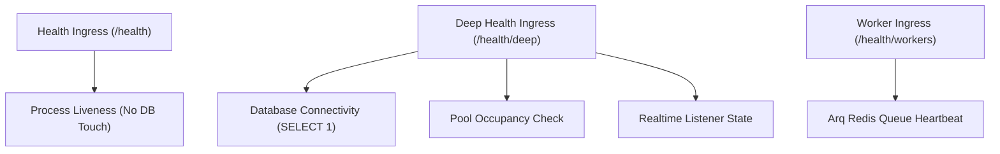

# AEGIS Health Check & Reliability Plan

This document details the multi-tiered health and readiness architecture for AEGIS.

---

## 1. Health Probe Hierarchy



### Endpoints:
1. **`GET /health`** (Liveness Probe):
   - Fast response (<5ms).
   - Does **not** touch the database pool, preventing container health checks from occupying pool slots during traffic bursts.
   - Used by DigitalOcean container orchestrator / Docker health check.
2. **`GET /health/deep`** (Readiness Probe):
   - Executes `SELECT 1` against Supabase PostgreSQL.
   - Reports current pool checked-out connections, capacity, and overflow.
   - Returns HTTP 503 if the database is unreachable or pool checkout times out.
3. **`GET /health/workers`**:
   - Inspects Arq Redis queue heartbeat and pending background job backlog.

---

## 2. Docker Compose Healthcheck Configuration

From `deploy/digitalocean/docker-compose.yml`:
```yaml
healthcheck:
  test: ["CMD-SHELL", "python - <<'PY'\nimport urllib.request\nurllib.request.urlopen('http://127.0.0.1:8000/health', timeout=5)\nPY"]
  interval: 30s
  timeout: 10s
  retries: 5
  start_period: 30s
```

---

## 3. Caddy Reverse Proxy Upstream Resilience

From `deploy/digitalocean/Caddyfile`:
```caddy
{$API_HOSTNAME} {
  encode zstd gzip

  reverse_proxy imperium-api:8000 {
    lb_try_duration 45s
    lb_try_interval 1s
  }
}
```
- **Hold Duration**: Caddy holds incoming connections up to 45 seconds while containers rebuild or restart.
- **Retry Scope**: Only connection errors (e.g. `ECONNREFUSED` during container bootstrap) are retried; requests already accepted by FastAPI are never resent.
