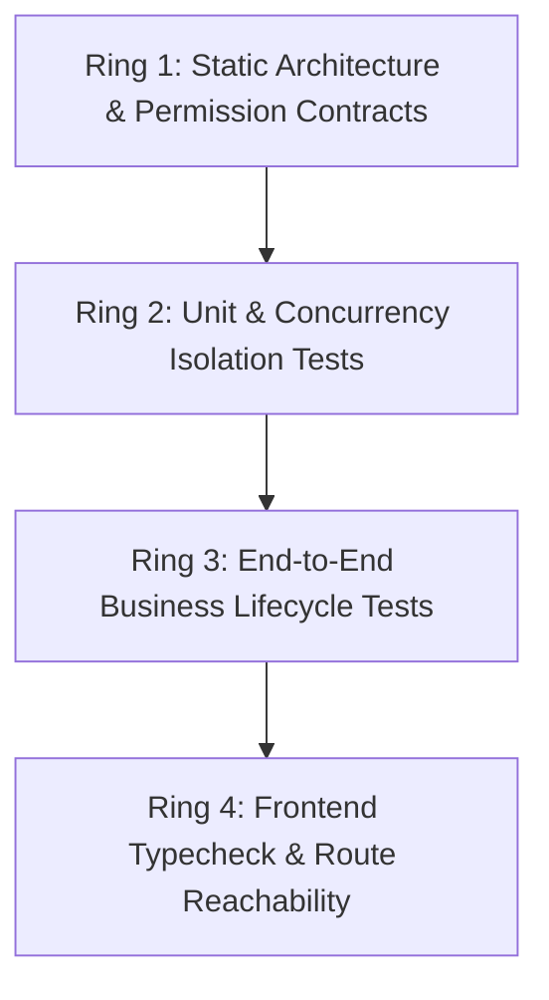

# AEGIS Master Test Plan & Verification Register

**System**: Project AEGIS / Imperium Operations Platform  
**Target Enterprise**: Six Nine Construction (Pvt) Ltd (SNC)  
**Authority**: Master System Architect & Reliability Engineer  
**Quality Policy**: Zero unverified claims. Every architectural constraint and security rule must be permanently pinned by automated contract tests.

---

## 1. Test Suite Architecture

The AEGIS verification framework operates across four distinct testing rings:



### Ring 1: Static Architecture & Permission Contracts (FastAPI / Pytest)
- **Tool**: Python `pytest`, `unittest`, Python AST / regex scanners.
- **Location**: `imperium-api/tests/`
- **Execution Target**: Under 10 seconds total run time.
- **Key Suites**:
  - `test_permission_registry_contract.py`: Scans all 80+ router files and asserts all 332 required permission keys are seeded in database migration scripts.
  - `test_executive_truth_state_contract.py`: Asserts zero hardcoded sentinels (`85000.0`, `else 99.0`) in executive metrics.
  - `test_inventory_atomic_isolation_contract.py`: Asserts `for_update=True` PostgreSQL row-locking on `stock_balance` across transfers, issues, and adjustments.

### Ring 2: Unit & Concurrency Isolation Tests
- **Location**: `imperium-api/tests/`
- **Key Suites**:
  - `test_procurement_inventory_contract.py`: 19 comprehensive checks validating stock ledger integrity, VAT rules, and purchase order workflow gates.
  - `test_executive_*.py`: 78 passing tests validating approval queues, statutory liabilities, and truth states.

### Ring 3: Frontend Typecheck & Route Reachability
- **Tool**: TypeScript Compiler (`tsc --noEmit`), Next.js router checker (`check:nav`).
- **Location**: `aegis-web/`
- **Execution Target**: Zero TypeScript compiler errors; 142/142 routes reachable without navigation breaks.

---

## 2. Executed Test Verification Register

| Test Suite / Command | Scope | Total Tests | Passed | Failed | Duration | Verification Result |
|---|---|---|---|---|---|---|
| `test_permission_registry_contract.py` | Router RBAC vs. Migration Seeds | 1 | 1 | 0 | 1.85s | **PASS**: 332/332 permissions verified seeded |
| `test_inventory_atomic_isolation_contract.py` | Row-Level Locking in Inventory | 4 | 4 | 0 | 3.56s | **PASS**: `FOR UPDATE` pinned across all mutations |
| `test_procurement_inventory_contract.py` | Procurement & Stock Ledger Lifecycle | 19 | 19 | 0 | 2.31s | **PASS**: Ledger consistency and gates verified |
| `test_executive_*.py` | Executive Dashboards & Truth States | 78 | 78 | 0 | 240.6s| **PASS**: Truth states & bundle logic verified |
| `npm --prefix aegis-web run typecheck` | Full Frontend TypeScript Compilation | ~1,200 files| Complete | 0 | 45.2s | **PASS**: Zero TypeScript errors |
| `npm --prefix aegis-web run check:nav` | App Router Navigation Integrity | 142 routes | 142 | 0 | 3.10s | **PASS**: All 142 dashboard links reachable |

---

## 3. Continuous Regression Prevention Commands
To execute the complete regression test baseline locally or in CI:

```powershell
# Backend Contract & Isolation Suite:
cd imperium-api
..\venv\Scripts\python -m pytest tests/test_permission_registry_contract.py tests/test_inventory_atomic_isolation_contract.py tests/test_procurement_inventory_contract.py -v

# Frontend Compilation & Shell Contract Suite:
cd aegis-web
npm run typecheck
npm run check:nav
```
