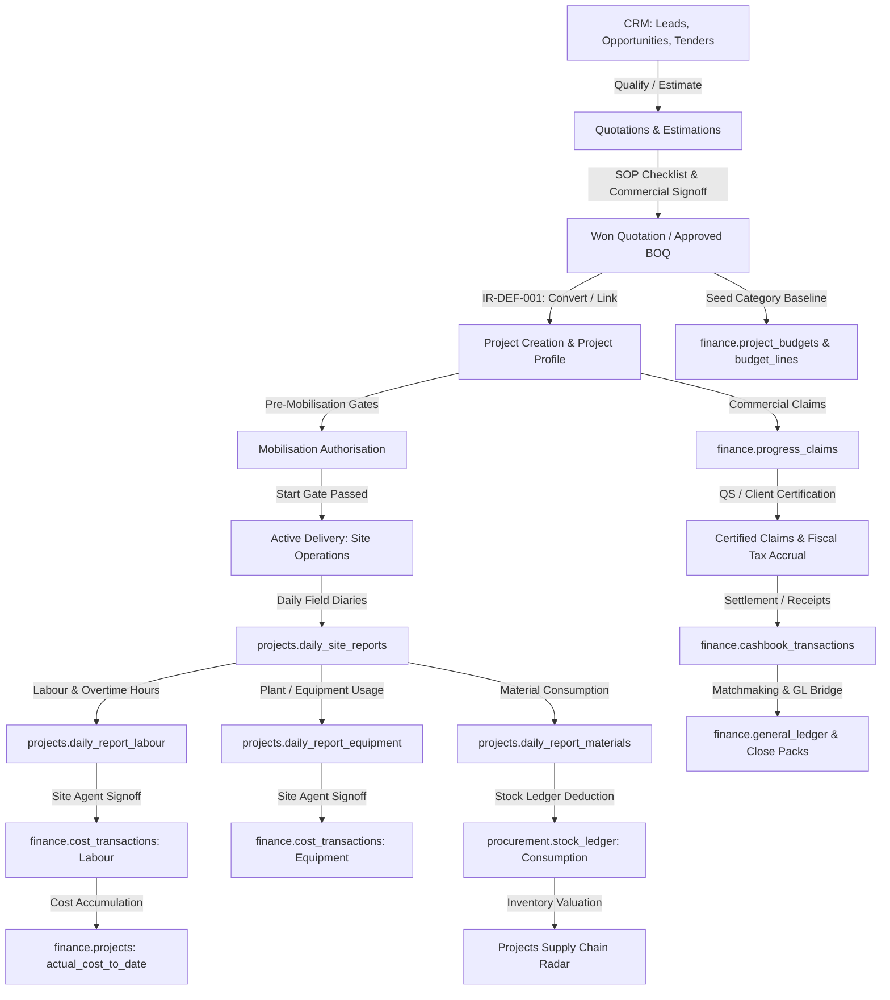

# OPERATION IRONCLAD: SYSTEM MAP & WORKFLOW TRACEABILITY

**System**: AEGIS / Imperium Enterprise Resource Planning Ecosystem  
**Client**: Six Nine Construction (Private) Limited  

---

## 1. End-to-End Enterprise Architecture Trace

---

## 2. Core Operational Integration Boundaries

### Boundary 1: Quotations ↔ Projects
- **Authoritative Source**: `finance.quotations` (lines, categories, calculations, approved BOQs).
- **Consumer**: `projects.projects` & `finance.project_budgets`.
- **Target Invariant**: Approved quotation execution costs (materials, labour, equipment, subcontract, overhead, contingency) seed the project's target budget with margin excluded. Once linked, quotation and project mutually reference each other.

### Boundary 2: Projects ↔ Site Operations Field Logs
- **Authoritative Source**: `projects.daily_site_reports`, `projects.daily_report_labour`, `projects.daily_report_equipment`, `projects.daily_report_materials`.
- **Consumer**: Project Workspace (`/dashboard/projects/[id]/site-logs`), Project Team attendance, and Site Operations Command (`/dashboard/site-operations`).
- **Target Invariant**: Daily reports must hydrate for all authorized project members (Site Engineer, Foreman, PM, QS) without requiring Executive dashboard permissions. Navigating between project logs and site command must maintain project context.

### Boundary 3: Project Financials ↔ Corporate Finance Command
- **Authoritative Source**: `finance.cost_transactions`, `finance.commitments`, `finance.progress_claims`, `finance.variations`, `finance.cashbook_transactions`.
- **Consumer**: Project Financials cockpit (`/dashboard/projects/[id]/financials`) & Finance Command (`/dashboard/finance/project-financials`).
- **Target Invariant**: A project's contract value, exposure, actuals, and margin match identically whether viewed from the Project Workspace or the Corporate Finance Command. Deep-linking to Finance preserves project selection.

### Boundary 4: Projects Supply Chain ↔ Site Materials ↔ Procurement Command
- **Authoritative Source**: `procurement.stores`, `procurement.stock_ledger`, `procurement.purchase_orders`, `procurement.material_requests`.
- **Consumer**: Project Materials (`/dashboard/projects/[id]/materials`), Site Operations Materials (`/dashboard/site-operations?tab=materials`), and Procurement Command (`/dashboard/procurement`).
- **Target Invariant**: Requisitions raised by site engineers against approved project BOQs are visible in Procurement for RFQ issuance and PO conversion, with stock issues attributed to project inventory value.

### Boundary 5: Project Team & Workforce ↔ Site Labour Register ↔ HR & Payroll
- **Authoritative Source**: `projects.project_roles`, `finance.site_workers`, `projects.daily_report_labour`, `core.users`.
- **Consumer**: Project Team (`/dashboard/projects/[id]/team`), Site Operations Labour Register (`/dashboard/site-operations?tab=register`), and Workforce Command (`/dashboard/workforce`).
- **Target Invariant**: Casual project hires and permanent company staff allocated to a project can have their attendance, shifts, and overtime recorded directly in site diaries, reconciling into site payroll without permission blocks.
